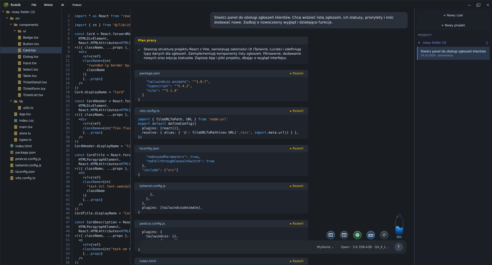

# Kodnik — Local AI Coding Agent for Windows

**Create, edit and fix software with local AI, directly on your own computer.**

Kodnik is a Windows desktop AI coding agent. It works with your actual project files, analyzes code, creates and edits programs, runs terminal commands and helps complete multi-step development tasks.

**Run AI locally. Work with real projects. Stay in control.**

[🌍 Official website — English](https://kodnik.com/) | [🇵🇱 Polska strona](https://kodnik.pl/) | [Download free DEMO](https://kodnik.com/#demo)

---

## Kodnik in action

*Real desktop application for Windows. Screenshot should reflect the latest version.*

## What can Kodnik do?

- **Create software** — build applications and project files from natural-language instructions.
- **Edit existing projects** — analyze, modify and organize code across project files.
- **Find and fix bugs** — inspect code, investigate errors and apply changes.
- **Work with the terminal** — share a project terminal session with the user, including PowerShell, CMD and Git Bash.
- **Plan and execute tasks** — work through multiple development steps with visible progress.
- **Undo file changes** — restore previous file states using saved restore points.
- **Browse the web** — use ONLINE tools to search websites, inspect documentation and download files.
- **Work offline** — run local AI models without sending your project to a remote AI model.

## Local AI models

Kodnik supports local Qwen model variants, including:

| Model | Architecture | Main advantage |
|---|---|---|
| Qwen 27B | Dense | Stronger results on demanding coding tasks |
| Qwen 35B-A3B | Mixture of Experts (MoE) | Efficient inference with fewer active parameters |

Available model files and quantizations can be selected through the application's AI Models panel.

**Only one AI model runs at a time.**

Kodnik provides the coding-agent environment, tools and execution system. The AI model provides the reasoning capabilities. Performance and accuracy depend on the selected model, quantization and hardware.

Model files are distributed separately under their respective licenses.

## Automatic hardware configuration

Kodnik detects your computer's hardware and configures local model execution.

- Detects CPU, RAM, GPU and VRAM.
- Supports compatible CUDA and Vulkan acceleration backends.
- Calculates model-layer allocation between GPU memory and system memory.
- Supports CPU-only execution when necessary.
- Adjusts configuration to available hardware resources.

A dedicated GPU can significantly improve performance, but is not mandatory.

## OFFLINE and ONLINE

**OFFLINE:** Work with local models and project files on your own computer without requiring a permanent internet connection.

**ONLINE:** Enable internet tools when you want Kodnik to search the web, inspect documentation or download resources.

Internet access is required for initial model downloads, account activation and application updates.

## Free DEMO — 2 hours

Try Kodnik on your computer before purchasing.

The DEMO includes local model testing, project work, code editing, terminal access and ONLINE capabilities.

- 2 hours of total application runtime.
- The timer pauses when the application is closed.
- No purchase or Kodnik account required.
- Available for Windows 10/11 64-bit.

**[Download Kodnik DEMO](https://kodnik.com/#demo)**

## Kodnik FULL — 12-month license

The paid version provides access to Kodnik for 12 months, including updates during the valid license period.

| Market | Price |
|---|---|
| Poland | **99 PLN / 12 months** |
| International | **11.99 EUR / 12 months** |

Each license term is purchased separately.

**No automatic renewal. No automatic recurring charges.**

The paid version includes Thinking mode and application updates during the license term.

[Purchase — Poland](https://kodnik.pl/) | [Purchase — International](https://kodnik.com/)

Previous purchases retain their original license terms.

## System requirements

- Windows 10 or Windows 11, 64-bit.
- x86-64 processor with AVX2 support.
- RAM and disk space dependent on the selected local model.
- Compatible GPU optional; GPU acceleration can improve speed.
- Internet connection for initial setup, model downloads and updates.

Unsure about performance on your PC? Test the DEMO before purchasing.

## Feedback and bug reports

Kodnik is under active development.

Bug reports, compatibility issues and technical feedback are welcome.

[Open a GitHub issue](https://github.com/kodnik-ai/kodnik/issues)

Please include the task, model, expected result, actual behavior and relevant diagnostics when possible.

## Official links

- English: https://kodnik.com/
- Polish: https://kodnik.pl/
- GitHub: https://github.com/kodnik-ai/kodnik
- Contact: kontakt@kodnik.pl

## About this repository

This repository is the official public GitHub presence of Kodnik.

**Kodnik is proprietary software. Its application source code is not publicly available in this repository.**

The repository is used for product information, documentation, technical feedback and public project updates.

---

**Kodnik — Local AI. Your code. Your machine.**
